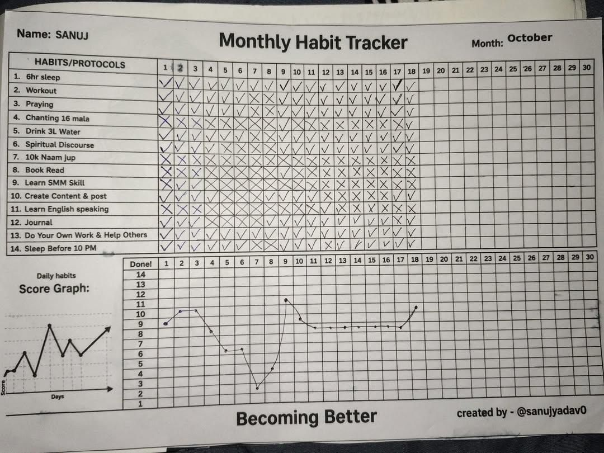

# BetterDays

A private daily habit tracker that turns a paper monthly sheet into something you can check off on your phone or laptop. Habits, completions, and your name stay in this browser. Nothing is sent to a server.

The tagline on the sheet is **Becoming Better**.

## What it is

BetterDays is a single-page Next.js app modeled on a handwritten monthly habit grid: one row per habit, one column per day, a score under the days, and a name and month at the top. The first load starts from that sheet — 14 habits, October’s marks, and the same header and footer — so the digital version opens looking like the paper one.

## What it does

- **Today** — greet you, show today’s progress, and let you mark habits done, mark everything done, or reset the day. Filter by category or by what’s still open.
- **Monthly sheet** — a 31-day paper grid. Each cell cycles empty → completed (✓) → skipped (✕). Move between months, and a score graph sits under the days the way it does on the original sheet.
- **Habits** — add, edit, reorder, and delete habits. Each habit has a name, category, and icon.
- **Insights** — streak, 30-day trend, which weekdays you finish more often, and a consistency list per habit.
- **Profile** — your name and tagline, shown on the monthly header and in the footer.
- **Data** — export a JSON backup, import one back, reset to the original reference sheet, or clear everything.

A **Reference** button in the header opens the original paper photo so you can compare the app with the sheet it came from.

## The paper sheet

This photo is the source. The grid, the 14 habits, the ✓ / ✕ marks, the daily score row, the name and month header, and the “Becoming Better” line all come from it.



## Privacy

Habits, daily records, and profile are stored in `localStorage` under this site. There is no account, no cloud sync, and no cookies. Export a backup if you want a copy outside the browser.

## Getting started

```bash
npm install
npm run dev
```

Open [http://localhost:3000](http://localhost:3000).

```bash
npm run build
npm start
```

## Stack

Next.js, React, and Tailwind CSS. Charts use Recharts. Data never leaves the browser.
